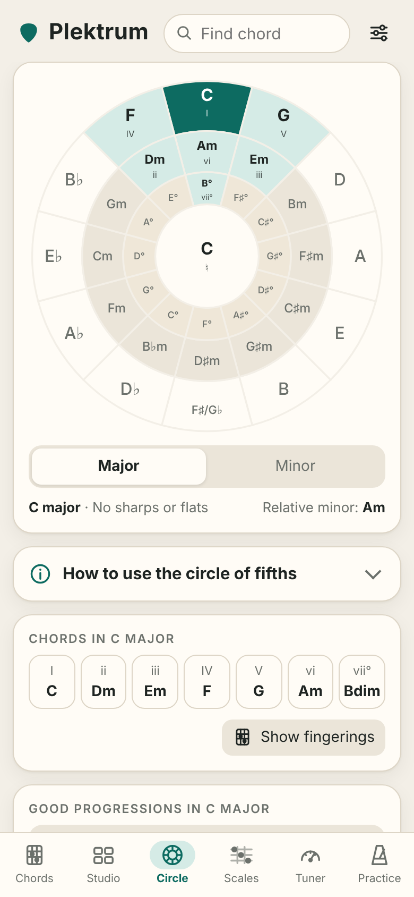

# Plektrum (Android)

A toolbox for string players – guitar, bass, ukulele, mandolin, banjo, violin and more: chords,
progressions with strumming and drum backing, the circle of fifths, scales, a tuner and a metronome.
Fully offline – no internet permission, no ads, no accounts. Everything lives in `app/src/main/assets/`.

  
  
  
  

## What's inside

**Chords**
- Guitar, ukulele (standard and baritone), mandolin, 5-string banjo, tenor banjo and bass
- 36 chord types in all 12 keys, plus slash chords over any bass note
- Fingerings worked out on the device for each instrument – up to 24 per chord, easiest first
- Charts show fingers, note names or intervals (1, 3, 5 …), with the starting fret up the neck
- Search by name (`Am7`, `C/G`, `F#m7b5`, `Bbmaj7` …), swipe between fingerings
- Strum or arpeggio playback with a synthesised plucked-string sound
- Unlimited favourites (they remember the instrument)

**Studio** – build progressions of up to 16 chords, pick any fingering, reorder, transpose and save
them. Play them back in 4/4, 3/4, 2/4, 5/4, 6/8, 12/8 or 7/8 with 39 strumming patterns (accents,
muted chucks, stabs, palm muting, syncopated pushes, reggae and ska offbeats, funk sixteenths,
shuffle, Travis picking, boom-chick, arpeggios …) and 21 drum beats (rock and pop backbeats,
half-time, four on the floor, funk, shuffle, train beat, one-drop, bossa nova, Motown, waltz, slow
blues …). Swing, count-in, metronome click, and a step grid that shows the pattern as it plays.
Suggested progressions for any major or minor key.

**Circle of fifths** – interactive: tap a key and the chords that belong to it light up with their
roman numerals. Key signature, relative key, the seven diatonic chords (tap to hear), and good
progressions for that key that play on the circle or go straight to the Studio.

**Scales** – 51 scales and arpeggios in eight groups: pentatonic and blues, the major modes, melodic
minor modes (altered, Lydian dominant …), harmonic and exotic scales (Phrygian dominant, double
harmonic, Hungarian, Neapolitan, Persian …), bebop, symmetric (whole tone, diminished, augmented),
Japanese scales, and arpeggios. Shown on the fretboard of any of 14 instruments in any of their
tunings – guitar, 7-string, bass, ukulele, mandolin, mandola, banjo, tenor banjo, violin, viola,
cello, double bass (fretless ones with semitone lines). Positions (the five pentatonic boxes and
three-notes-per-string on guitar and bass), notes or degrees, step pattern (W W H …), correctly
spelled note names, the chords of the scale as triads or 7th chords, tap to hear any note.

**Tuner** – needle, strobe wheel or strobe bands, with a pitch history trace and signal level.
Fifteen instruments, each with its own headstock and common tunings: guitar (17 tunings), 7-string
and 12-string guitar, 4-, 5- and 6-string bass, ukulele, mandolin, mandola, 5-string and tenor banjo,
violin, viola, cello and double bass – plus a custom tuning for each. Tap a peg to tune one string;
paired strings (12-string, mandolin) are marked together. Chromatic mode, A4 calibration
(415–466 Hz), sensitivity, seven temperaments (equal, just, Pythagorean, ¼-comma meantone,
Werckmeister III–V, Kirnberger II–III, Vallotti, Young, Kellner and five kinds of meantone – 16 in all) on any key, and a pitch pipe. Steady read-out that
holds the last note for a moment after it fades.

**Practice** – a metronome in 2/4, 3/4, 4/4, 5/4, 6/8, 9/8, 12/8, 5/8 and 7/8 (with groupings such as
2 + 2 + 3), subdivisions, swing, tap tempo and accent patterns for syncopation (backbeat, offbeats,
Charleston, tresillo, son/rumba/bossa clave, shuffle, gallop) – tap any step to accent, soften or
silence it. Plus a ten-question chord challenge.

Plus left-handed mode, light/dark/automatic theme, English and Swedish (follows the phone), and
optional Swedish note names (H and B).

## Download

**[Download the latest APK](https://github.com/jonsolberg/guitarchords/releases/latest/download/Plektrum.apk)** · [all releases](https://github.com/jonsolberg/guitarchords/releases)

## Building

Push to GitHub – the workflow builds the APK, publishes `Plektrum.apk` on the `apk` branch and
attaches it to a release. Or open the folder in Android Studio and choose *Build → Build APK(s)*.

## License

Copyright © 2026 Jon Solberg

This program is free software: you can redistribute it and/or modify it under the terms of the
GNU General Public License as published by the Free Software Foundation, either version 3 of the
License, or (at your option) any later version.

This program is distributed in the hope that it will be useful, but WITHOUT ANY WARRANTY; without
even the implied warranty of MERCHANTABILITY or FITNESS FOR A PARTICULAR PURPOSE. See the
[GNU General Public License](LICENSE) for more details.
