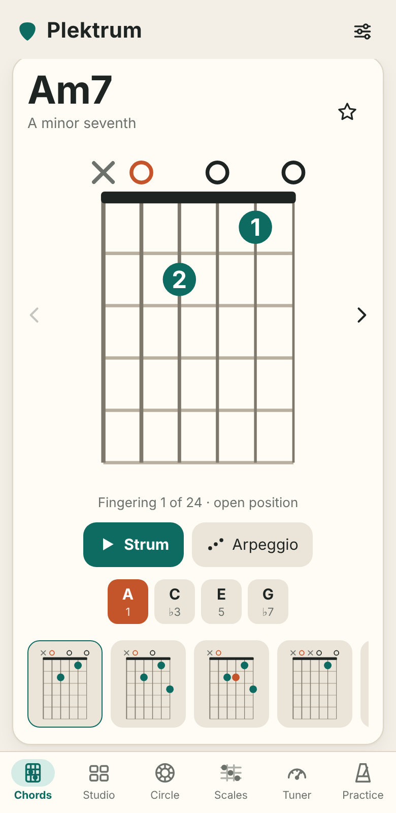
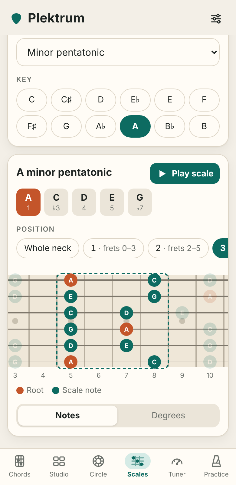
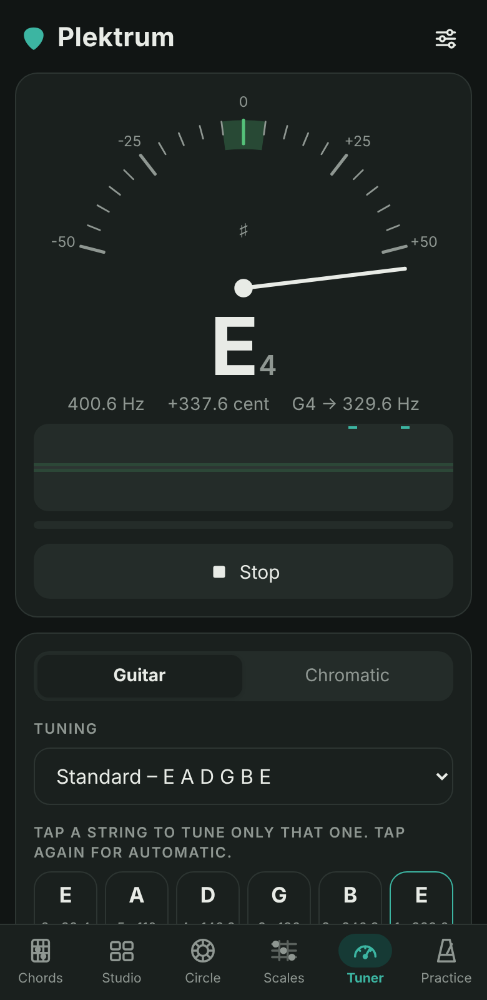

# Plektrum (Android)

A toolbox for guitarists: chords, progressions, the circle of fifths, scales, a tuner and a metronome.
Fully offline – no internet permission, no ads, no accounts. Everything lives in `app/src/main/assets/`.

  
  
  
  

## What's inside

**Chords**
- 36 chord types in all 12 keys, plus slash chords over any bass note (5,184 chord names)
- Fingerings worked out on the device – up to 24 per chord, open shapes first, then barre chords up the neck
- Diagrams with finger numbers, barres, muted/open strings, root notes marked, optional note names
- Search by name (`Am7`, `C/G`, `F#m7b5`, `Bbmaj7`, `Esus` …), swipe between fingerings
- Strum or arpeggio playback with a synthesised plucked-string sound
- Unlimited favourites

**Studio** – build progressions of up to 16 chords, pick any fingering, reorder, transpose, loop them
at a set tempo with different strum patterns and a metronome click, and save them. Suggested
progressions for any major or minor key.

**Circle of fifths** – interactive: tap a key and the chords that belong to it light up with their
roman numerals. Key signature, relative key, the seven diatonic chords (tap to hear), and good
progressions for that key that play on the circle or go straight to the Studio.

**Scales** – 20 scales on a 17-fret fretboard: minor/major pentatonic, blues, major, minor, harmonic
and melodic minor, all the modes, phrygian dominant, Hungarian minor, whole tone, diminished,
hirajōshi and chromatic. The five pentatonic boxes (and three-notes-per-string positions for
seven-note scales), notes or scale degrees, tap a note to hear it, play the scale.

**Tuner** – needle display with a history trace and signal level, guitar or chromatic mode,
17 tunings (standard, half/whole step down, drop D/C♯/C/B, DADGAD, open G/D/E/A/C/Dm, all fourths,
new standard, baritone, and a custom tuning), tune a single string by tapping it, A4 calibration
(415–466 Hz), seven temperaments (equal, just, Pythagorean, ¼-comma meantone, Werckmeister III,
Kirnberger III, Vallotti) on any key, and a pitch pipe.

**Practice** – metronome (40–240 BPM, 2–7 beats per bar, tap tempo) and a ten-question chord challenge.

Plus left-handed mode, light/dark/automatic theme, English and Swedish (follows the phone), and
optional Swedish note names (H and B).

## Download

**[Download the latest APK](https://github.com/jonsolberg/guitarchords/releases/latest/download/Plektrum.apk)** · [all releases](https://github.com/jonsolberg/guitarchords/releases)

## Building

Push to GitHub – the workflow builds the APK, publishes `Plektrum.apk` on the `apk` branch and
attaches it to a release. Or open the folder in Android Studio and choose *Build → Build APK(s)*.

## License

Copyright © 2026 Jon Solberg

This program is free software: you can redistribute it and/or modify it under the terms of the
GNU General Public License as published by the Free Software Foundation, either version 3 of the
License, or (at your option) any later version.

This program is distributed in the hope that it will be useful, but WITHOUT ANY WARRANTY; without
even the implied warranty of MERCHANTABILITY or FITNESS FOR A PARTICULAR PURPOSE. See the
[GNU General Public License](LICENSE) for more details.
