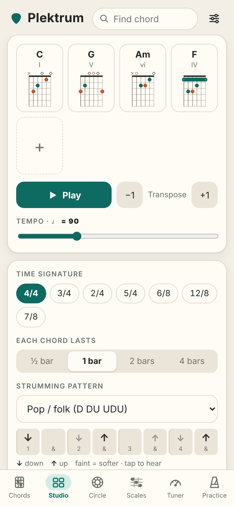
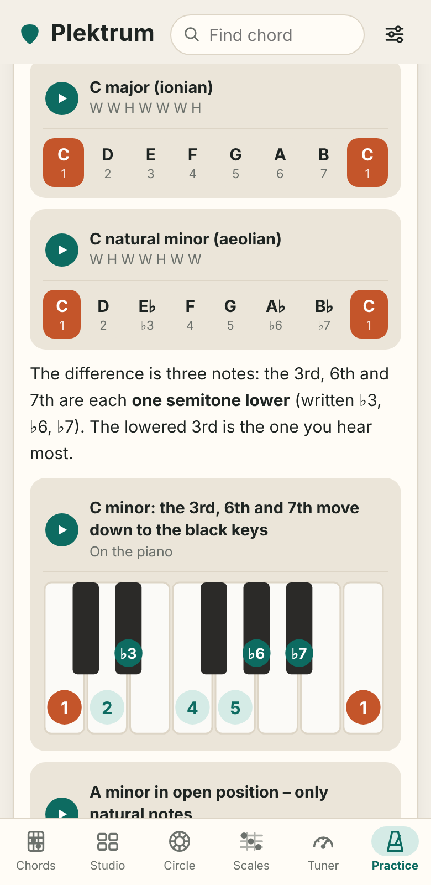
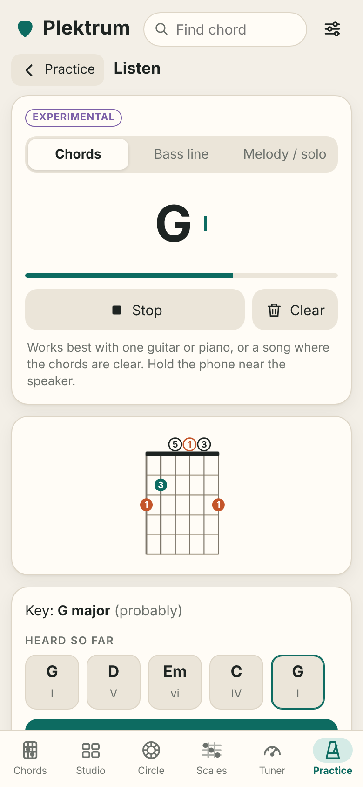

# Plektrum (Android)

A toolbox for guitar, ukulele, bass and other string players: chords, a tuner, scales, a metronome and a
music theory course. Free, fully offline, no ads and no accounts.

  
  
  
  

  
  
  
  

## Download

**[Download the latest APK](https://github.com/jonsolberg/plektrum/releases/latest/download/Plektrum.apk)** · [all releases](https://github.com/jonsolberg/plektrum/releases)

Plektrum isn't on Google Play, so Android asks before installing it. When you open the APK, allow your
browser or file manager to **install unknown apps** (Android shows a switch for it), then tap *Install*.

## What's inside

The app has six tabs: **Chords, Studio, Circle, Scales, Tuner** and **Practice**.

### Chords
- Guitar, ukulele (standard and baritone), mandolin, 5-string banjo, tenor banjo and bass.
- 36 chord types in all 12 keys, plus slash chords over any bass note.
- Alternative tunings such as open G, open D, DADGAD, drop D and low-G ukulele (for example, how to play Cm in open G).
- Up to 24 fingerings per chord, easiest first, worked out on the phone for each instrument.
- Charts show fingers, note names or intervals (1, 3, 5 …). Search by name (`Am7`, `C/G`, `F#m7b5` …) and swipe between fingerings.
- Strum or arpeggio playback, with the dots lighting up as each string sounds. Unlimited favourites.

### Studio
Build progressions of up to 16 chords, then transpose, reorder and save them. Play them back with 39 strumming
patterns and 21 drum beats, in time signatures from 2/4 to 12/8 and 7/8, with swing, count-in and a metronome
click. Suggested progressions for any key.

### Circle of fifths
Tap a key and its chords light up with their Roman numerals. Shows the key signature, the relative key, the seven
chords of the key (tap to hear) and good progressions that you can send to the Studio.

### Scales
51 scales and arpeggios in eight groups: pentatonic and blues, the major modes, melodic minor modes, harmonic and
exotic scales, bebop, symmetric scales, Japanese scales and arpeggios. They are shown on the fretboard of any of
14 instruments, in any of their tunings, with positions, note names or degrees, the step pattern and the chords of
the scale. Tap a note to hear it.

### Tuner
- Needle, strobe wheel or strobe bands, with an optional pitch history trace.
- Fifteen instruments with their common tunings, plus a custom tuning for each.
- Chromatic mode, A4 calibration (415–466 Hz), 16 temperaments and a pitch pipe.
- **Input:** the tuner shows what it is listening to – the phone's microphone or a cable (a USB-C audio interface,
  a headset adapter or a guitar cable adapter). Choose the input under *Input*, or leave it on *Automatic*.

### Practice
- **Music theory:** 52 short lessons in nine chapters, one a week for a year – from tuning and your first chords
  to reading music, CAGED, jazz chords and writing your own songs. Each lesson has examples on the piano, the guitar
  neck and in sheet music that you can play, a *Try it* exercise and a summary. The whole course can be saved as a
  PDF book ([sample](docs/plektrum-music-theory.pdf)) or read as an [e-book (EPUB)](docs/plektrum-music-theory.epub).
- **Metronome:** 2/4 to 12/8 plus 5/8 and 7/8, subdivisions, swing, tap tempo and accent patterns.
- **Quizzes** – ten questions each, with four levels (*Novice, Medium, Advanced, Expert*) and the best score kept per level.
  After every answer an explanation shows *why*, so the quizzes teach even if you know no theory.
  - *Name the chord* – from open C, G, Am and friends on Novice to diminished, augmented and extended chords on Expert.
  - *Name the note* and *Find the note* – on the fretboard of any fretted instrument, from natural notes on the first
    five frets to all twelve notes with the fret numbers hidden.
  - *Notes on the E and A strings* – learn the two lowest guitar strings by heart, where the root of every barre chord
    and power chord lives.
  - *Count up the neck* – start from a note you know and count one fret per semitone, the quickest way to find any note.
  - *Scales & keys* – notes of a key, key signatures, relative minors, chords in a key, modes, step patterns and intervals.
  - *Intervals by ear* (with a song to remember each one) and *Chord types by ear*.
- **Listen (experimental):** play a song to the phone and Plektrum tries to work out the **chords** (with the key and
  Roman numerals), the **bass line** or a **melody**, as chord charts and tab. Everything runs on the phone – nothing is
  recorded or sent anywhere.
  - It works **much better with a cable than with the microphone.** Plug the instrument or the music player into the
    phone through a USB-C audio interface or an adapter cable. Like the tuner, Listen shows which input it is using.
  - It hears the whole sound, so loud vocals, drums and dense mixes confuse it. Treat the result as a starting point
    and check it by ear.

### Settings and About
Left-handed mode, light/dark/automatic theme, English and Swedish (follows the phone), and optional Swedish note names
(H instead of B). The settings button (top right) also holds *About*: version, copyright, the source code, my website
and the Ko-fi link.

## Building

Push to GitHub – the workflow builds the APK and publishes it as a release (`Plektrum.apk` always points to the
newest). Or open the folder in Android Studio and choose *Build → Build APK(s)*. Everything the app shows lives in
`app/src/main/assets/`.

## Support

Plektrum is free, open source and has no ads. If you find it useful, you can
[support me on Ko-fi](https://ko-fi.com/jonsolberg) ❤️

## License

Copyright © 2026 Jon Solberg

This program is free software: you can redistribute it and/or modify it under the terms of the
GNU General Public License as published by the Free Software Foundation, either version 3 of the
License, or (at your option) any later version.

This program is distributed in the hope that it will be useful, but WITHOUT ANY WARRANTY; without
even the implied warranty of MERCHANTABILITY or FITNESS FOR A PARTICULAR PURPOSE. See the
[GNU General Public License](LICENSE) for more details.
